# Grid Stress Monitoring, Demand & Growth Modeling (ISO New England)

An end-to-end Azure data pipeline that combines **5-minute ISO-NE system load** with **10 years of
EIA electricity sales** to detect grid-stress events and forecast short-term demand in New England.

Course project for **DS591 Engineering for Big Data Workloads**, Boston University, Spring 2026 — Team 08:
Alexander Shah, Aijia Zhang, Samantha Gibson, Jiaxi Li.

> This repository is a curated, documentation-focused version of our team project, reorganized by Jiaxi Li
> to collect the code, Azure configuration, results and reports in one readable place.

`Azure Data Factory` · `ADLS Gen2 (medallion)` · `Event Hub` · `Stream Analytics` · `Synapse` · `Power BI` · `Python` · `scikit-learn` · `XGBoost`

---

## 1. Background

Electrification, industrial load and compute-heavy infrastructure (e.g. data centers) are changing
how much electricity regional grids must deliver, but operators rarely see real-time stress signals
and long-term demand trends side by side. We built a pipeline that does both for the ISO New England
region and used it to test four hypotheses stated up front in our proposal:

1. **Seasonal demand** — summer cooling load drives peaks across New England.
2. **AI infrastructure growth** — industrial/commercial consumption is rising 2022–2026.
3. **Weekly operational patterns** — weekday/weekend cycles create predictable stress.
4. **Forecast deviation ↔ stress** — sharp departures from expected load signal grid stress.

| Data | Source | Coverage | Path |
|---|---|---|---|
| 5-minute system load (streaming) | ISO-NE | Jul 2025 – May 2026, ~10.3k intervals | replay → Bronze → Silver → Gold |
| Monthly retail sales by state × sector (batch) | EIA API v2 | 2016–2025, 6 states × 3 sectors, 2,160 rows | ADF → Bronze → Silver → Gold |
| Annual peak load & monthly capacity reports (batch) | ISO-NE | 2016–2026 / 2024–2026 | ADF → Bronze |

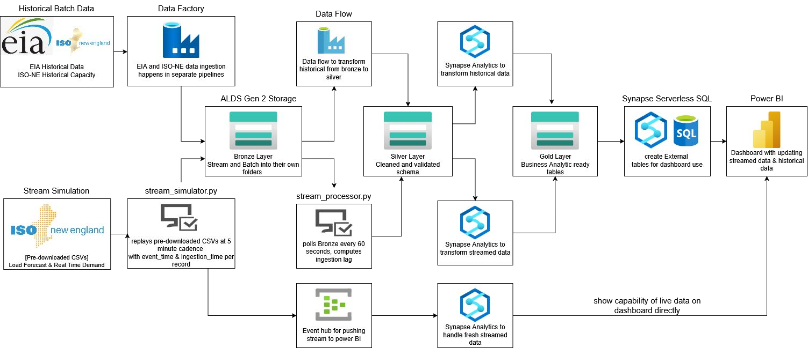

*In the deployed version, the live branch from Event Hub to Power BI ran on Azure Stream Analytics, and the
Silver → Gold steps ran in Synapse; the repository contains Python implementations of these transformations
(`transformation/`) that run against ADLS from any machine.*

## 2. Key findings

- **Next-5-minute load forecasting:** Linear regression on lag + rolling features reached **0.42% test MAPE**
  (RMSE 64 MW) with no overfitting — well below the ~2% error typical of ISO-NE's day-ahead forecast
  (a looser benchmark, since day-ahead is a much harder horizon).
- **Model complexity did not help:** Random Forest and XGBoost overfit (test/train MAPE ratio 2.2× and 2.4×),
  likely memorizing autocorrelation from the summer–winter training window and failing to transfer to the spring test period.
- **Stress detection:** 430 stress intervals (4.2%) over the collection period (the Silver arrival log, which
  still contains duplicate replays, counts 439). On the test window, linear regression had the highest stress F1
  (0.83) and Random Forest the highest precision; see [Known issues](#known-issues) for a caveat on how F1 was computed.
- **Hypotheses:** seasonal pattern *partially confirmed* (RI/MA summer-peaking at 1.24× / 1.08×, ME/VT winter-peaking at 0.87×);
  AI-driven industrial growth *refuted* (all six states show negative industrial CAGR 2022–2025, −0.3% to −5.7%);
  weekly cycles *partially confirmed* (data too coarse for a direct Monday-vs-weekend test);
  forecast-deviation stress *confirmed via a proxy* (19 stress episodes on the test window).

> **Stress definition used in code:** `stress_flag = |load − rolling 1-hour avg| / rolling 1-hour avg > 5%`.
> The official ISO-NE forecast feed was not accessible, so the 1-hour rolling average serves as the forecast proxy.
> Note that the executive summary (written earlier in the project) describes stress as a load-to-capacity ratio above 85%;
> that was the planned definition, and the code and all reported numbers use the deviation rule above.

## 3. Reports & deliverables

| Deliverable | Link |
|---|---|
| Executive summary (final report) | [docs/reports/Team08_Executive_Summary.pdf](docs/reports/Team08_Executive_Summary.pdf) |
| Final presentation slides | [docs/reports/Team08_Project_Presentation.pdf](docs/reports/Team08_Project_Presentation.pdf) |
| Power BI dashboard (export) | [docs/reports/Team08_PowerBI_Dashboard.pdf](docs/reports/Team08_PowerBI_Dashboard.pdf) |
| Azure setup, ADF pipelines and screenshots of the deployed data lake | [docs/azure_setup.md](docs/azure_setup.md) |
| Modeling notebook (with outputs) | [modeling/load_forecast_notebook.ipynb](modeling/load_forecast_notebook.ipynb) |

## 4. Results

**Model comparison (original course run)** — target: total system load 5 minutes ahead; chronological 80/20 split
(test window Apr 23 – May 3, 2026); RF and XGBoost hyperparameters grid-searched with 3-fold `TimeSeriesSplit` on the training set.

| Model | Train MAPE | Test MAPE | RMSE (MW) | Stress F1 | Overfit check |
|---|---|---|---|---|---|
| Persistence (baseline) | 0.821% | 0.987% | 133.1 | 0.679 | OK |
| **Linear Regression** | 0.329% | **0.424%** | **63.6** | **0.829** | OK |
| Random Forest | 0.327% | 0.726% | 108.5 | 0.826 | Overfit (2.2×) |
| XGBoost | 0.358% | 0.854% | 136.9 | 0.746 | Overfit (2.4×) |

The persistence baseline and the stress F1 scores have known timing issues; see [Known issues](#known-issues).

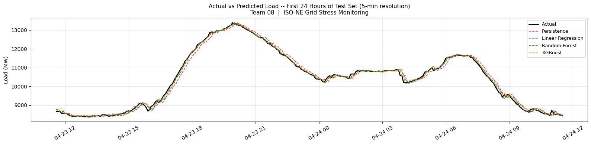

| Forecast error vs. horizon | EIA historical trends |
|---|---|
| 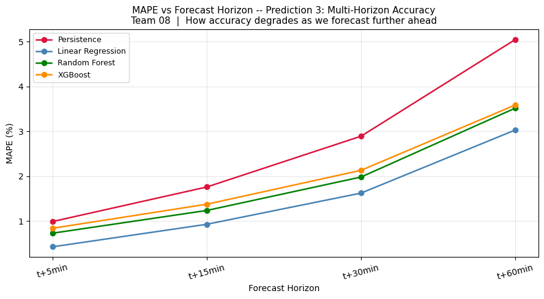 | 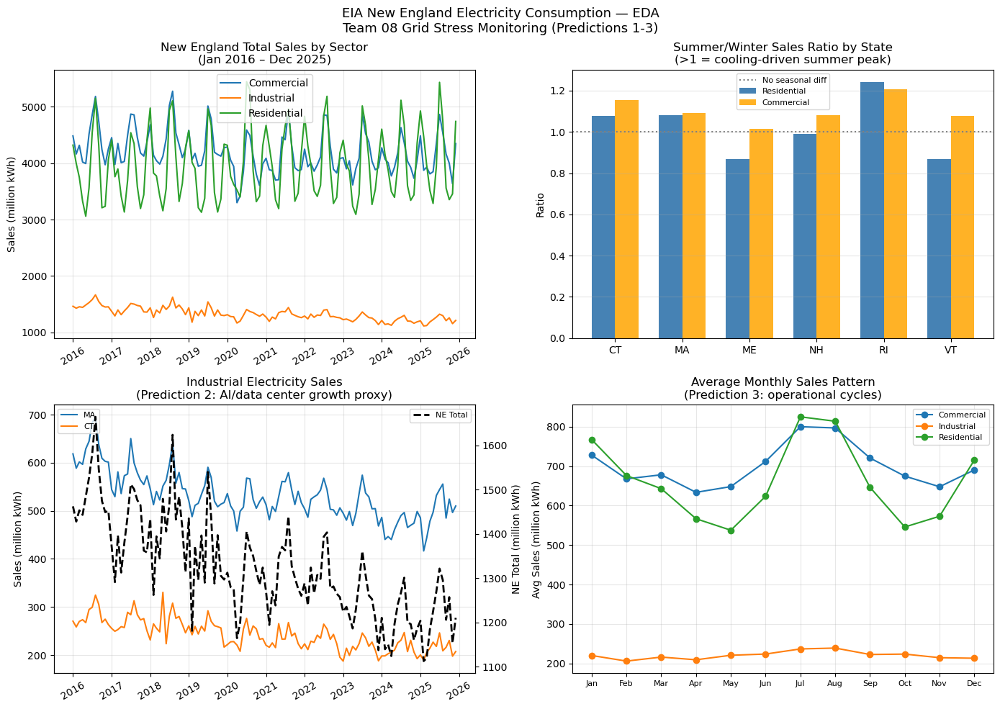 |

**Power BI** — historical dashboard and the live streaming demo (Event Hub → Stream Analytics → Power BI, replay accelerated):

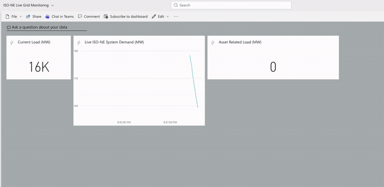

<details>
<summary>More figures</summary>

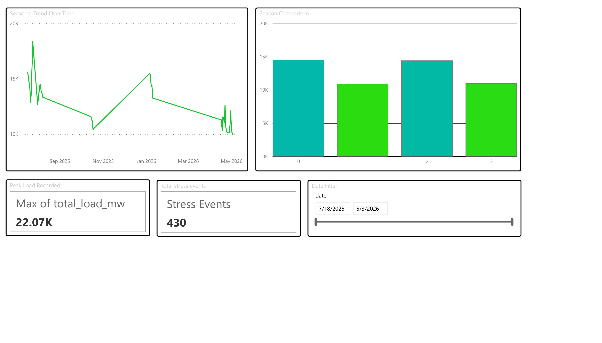
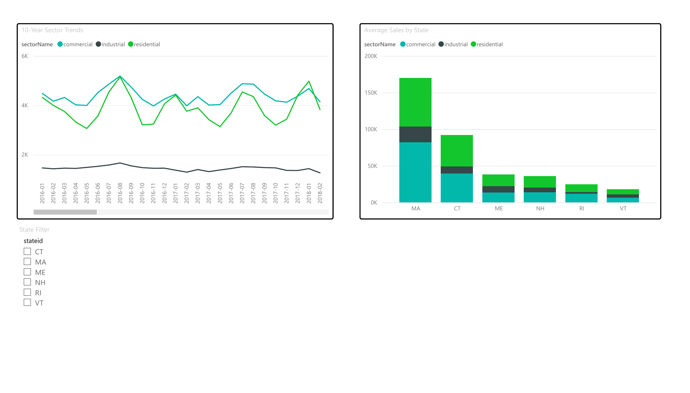
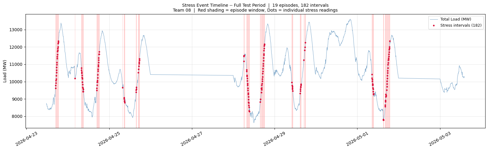
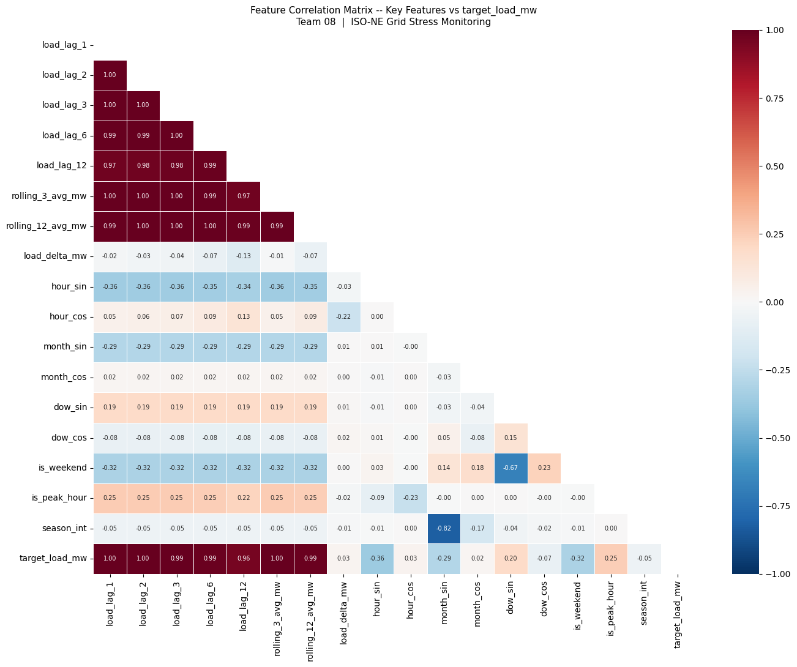
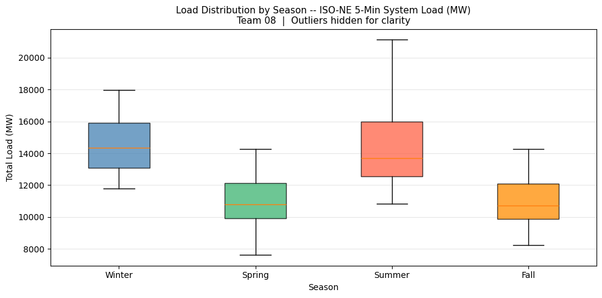
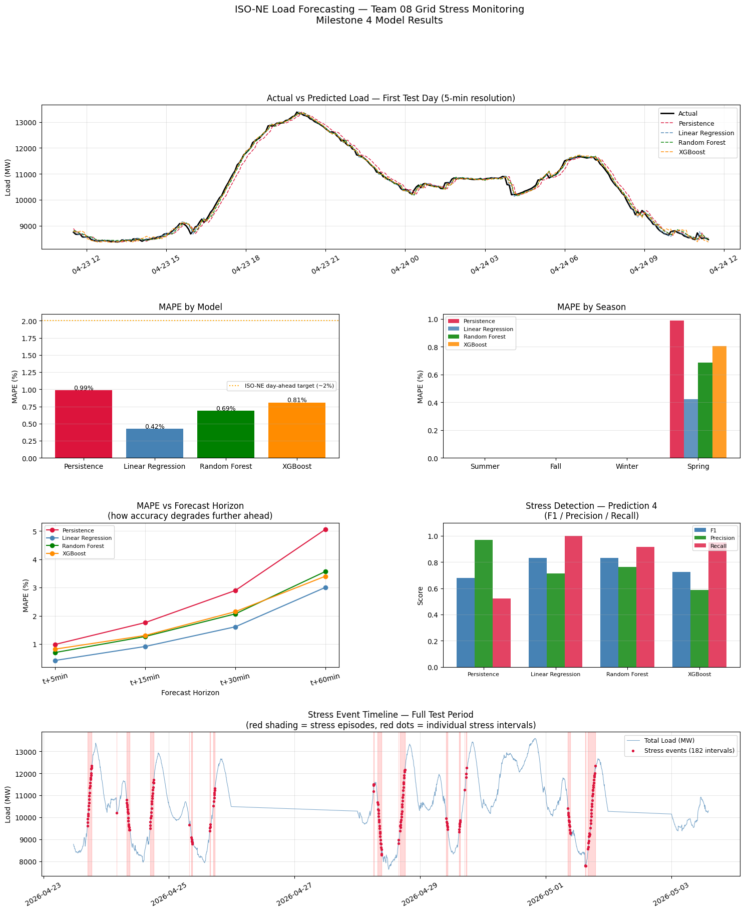

</details>

## 5. Quick start

**Environment:** the modeling notebook was run with Python 3.11; the ingestion scripts were also tested with
Python 3.10 (pandas 2.x). Azure resources are only needed for the full pipeline.

```bash
git clone https://github.com/li-jia-xi/Grid_stress_monitoring.git
cd Grid_stress_monitoring
python -m venv .venv
```

Activate the environment, then install the dependencies:

```bash
source .venv/bin/activate          # macOS / Linux
.venv\Scripts\activate             # Windows (Command Prompt or PowerShell)
pip install -r requirements.txt
```

### 5a. Local smoke test (no Azure account needed)

This only demonstrates the ingestion step: it parses the bundled sample file (24 synthetic rows in the real
ISO-NE CSV layout) and replays it without writing anywhere. It does not reproduce the model results.

```bash
python ingestion/stream_simulator.py --input-dir sample_data --max-rows 6 --dry-run --fast
```

Expected output:

```text
Found 1 CSV file(s) in sample_data
Loaded 24 total rows from 2026-04-17 00:00:00 to 2026-04-17 01:55:00

Replaying 6 rows at 300s cadence
Estimated total runtime: 30.0 minutes
Destination: DRY RUN (no writes)
------------------------------------------------------------
[1/6] event=2026-04-17 00:00:00  load=11275.0 MW  →  [dry-run] event_2026-04-17 00:00:00.json
...
[6/6] event=2026-04-17 00:25:00  load=11061.7 MW  →  [dry-run] event_2026-04-17 00:25:00.json
------------------------------------------------------------
Replay complete.
```

(`--fast` skips the real 5-minute sleep between events, so the "estimated runtime" line does not apply.)

### 5b. Full pipeline (requires your own Azure Storage account)

1. Deploy a storage account with `bronze`, `silver`, `gold` containers (or import [`infra/`](infra) templates).
2. `cp .env.example .env` and fill in `ADLS_CONNECTION_STRING` (and optionally the Event Hub variables).
3. Download ISO-NE "Real-Time Five-Minute System Load" CSVs into `./iso_ne_csvs/`.

```bash
python ingestion/stream_simulator.py --input-dir ./iso_ne_csvs --max-rows 288 --fast   # replay → Bronze (+ Event Hub)
python ingestion/stream_processor.py --once                                             # Bronze → Silver
python transformation/silver_to_gold.py                                                 # Silver → Gold feature matrix
python transformation/batch_silver_to_gold.py                                           # EIA Silver → Gold, writes figures/eia_eda.png
jupyter notebook modeling/load_forecast_notebook.ipynb                                  # train & evaluate models
```

The EIA steps before `batch_silver_to_gold.py` run in Azure Data Factory: `Ingest_EIA_Consumption_Data` pulls the API
data into Bronze, and `run_eia_transformation_to_silver` (data flow `team8_batch_bronze_to_silver`) flattens it into
Silver Parquet. Both are in [`infra/data-factory/`](infra/data-factory); pass the resulting Silver file with
`--silver-path`. Details are in [`docs/azure_setup.md`](docs/azure_setup.md). Not included in this repository: the
Stream Analytics query and the Power BI `.pbix` file.

### 5c. Reproducing the reported model results

The model results in Section 4 were computed from the Gold feature table `demand_features` built from ISO-NE
5-minute system load for July 2025 – May 2026. That table lived in the course Azure storage account, which is no longer accessible, and is not included here. To reproduce the numbers you need to rebuild it: download the ISO-NE "Real-Time Five-Minute System
Load" CSVs for that period (one file per day, named `rt_fiveminsysload_YYYYMMDD.csv`) into `./iso_ne_csvs/`, then run
the 5b pipeline. If you have a local copy of the table (a `.parquet` file or a
folder of part files), set `GOLD_LOCAL_PATH` in `.env` and the notebook will read it directly instead of ADLS.

## 6. Repository layout

```
.
├── ingestion/            stream_simulator.py (CSV replay → Bronze/Event Hub), stream_processor.py (Bronze → Silver)
├── transformation/       silver_to_gold.py (streaming features), batch_silver_to_gold.py (EIA aggregates)
├── modeling/             load_forecast_notebook.ipynb — models, evaluation, conclusions
├── notebooks/            milestone3_analysis.ipynb — streaming EDA
├── figures/              charts produced by the notebooks/scripts
├── infra/                exported ARM templates (Data Factory; resource group) — secrets replaced by placeholders
├── docs/                 reports/ (PDF deliverables), images/, azure_setup.md
├── sample_data/          small synthetic ISO-NE-format CSV for the smoke test
├── requirements.txt
└── .env.example
```

## Known issues

- **Persistence baseline is one step behind.** The target is the load at the next 5-minute interval, but the
  baseline predicts it with `load_lag_1` (the previous interval) instead of the current load. The baseline is
  therefore effectively a two-step-ahead forecast, so its error (0.987% MAPE) is likely overstated and the
  improvement of the learned models over it looks larger than it is.
- **Stress F1 compares different time steps.** Predicted stress uses the forecast for the next interval, while
  the label is the current interval's `stress_flag`. The F1 scores should be read as indicative only.

Both issues come from the original course notebook. Fixing them requires re-running the notebook on the Gold
table (see 5c); the numbers in this README are the original ones.

## Limitations & future work

- Streaming is simulated by replaying pre-downloaded CSVs (ISO-NE blocks programmatic CSV access); latency is micro-batch.
- The model test window covers only ~10 spring days, so seasonal generalization is untested.
- A SAS token was stored in a Synapse database credential because Key Vault access was restricted in the course
  subscription; production use should rely on a Key Vault–backed managed identity.
- Next steps: compare regions with confirmed data-center build-outs, and use the official ISO-NE forecast feed.

## Data sources & acknowledgements

- ISO New England, *Real-Time Five-Minute System Load*, *Net Energy and Peak Load*, *Seasonal Claimed Capability* reports — iso-ne.com
- U.S. Energy Information Administration, *Electricity Retail Sales* (API v2) — eia.gov/opendata
- Course: DS591, Boston University Faculty of Computing & Data Sciences, Spring 2026.
