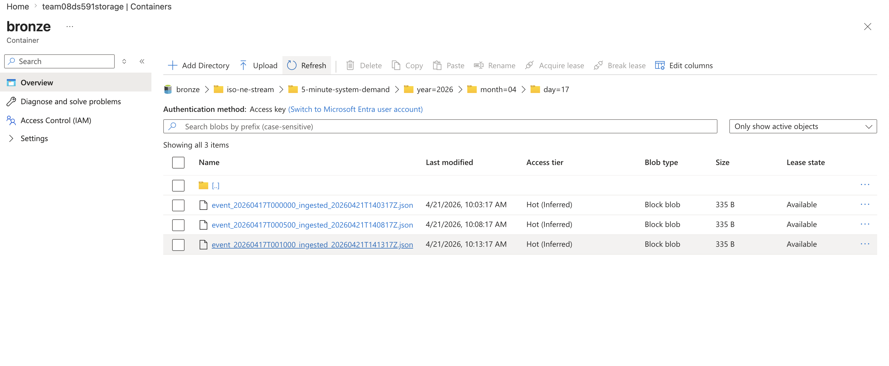
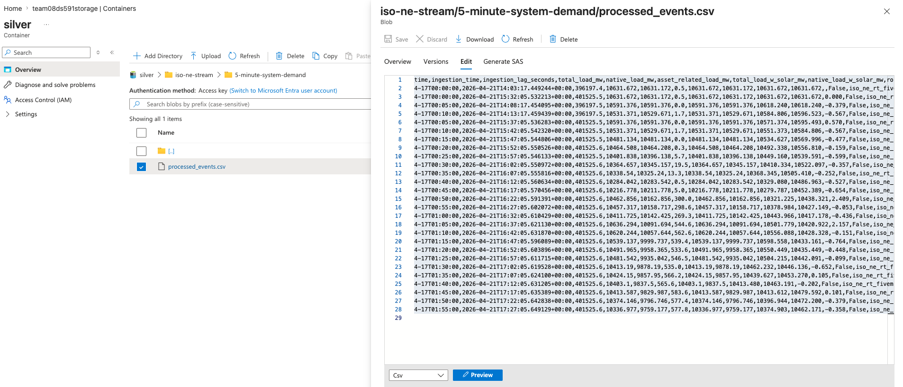

# Azure Environment & Pipelines

This page documents how the Azure side of the project was set up. The resources lived in a BU-managed course
subscription that is no longer accessible; this repository preserves the implementation, the exported ARM
templates in [`infra/`](../infra), recorded outputs, screenshots and the dashboard demo.

## Resources

| Resource | Name (course subscription) | Role |
|---|---|---|
| Resource group | `cds-ds562-sp26-team08-rg` | Container for all project resources (East US 2) |
| ADLS Gen2 storage | `team08ds591storage` | Medallion lake: `bronze` / `silver` / `gold` containers |
| Azure Data Factory (V2) | `cds-ds562-sp26-team08-data-factory` | Batch ingestion of historical ISO-NE + EIA data; EIA Bronze → Silver data flow |
| Event Hub namespace | `team08-eventhub` (hub `iso-ne-stream`) | Receives replayed 5-minute demand events |
| Stream Analytics job | `team08-stream-analytics` | Event Hub → Power BI live output |
| Synapse workspace | `team08-synapse` (Spark pool `team08sparkpool`) | Silver → Gold transformations in the deployed version; serverless SQL external tables for Power BI |
| Key Vault | `team08-secret-keys` | Intended secret store (see *Known limitations*) |

## Lake layout

```
bronze/
├── eia/batch-YYYYMMDD-HHmmss/eia_consumption.json        # EIA retail sales, 2016–2025
├── iso-ne-historical/
│   ├── peak-load/YYYY_peak_load.xlsx                      # 11 annual reports (2016–2026)
│   └── capacity/YYYY-MM_capacity.xlsx                     # 27 monthly SCC reports (2024-01 → 2026-03)
└── iso-ne-stream/5-minute-system-demand/year=YYYY/month=MM/day=DD/*.json
silver/
├── eia-batch/part-*.parquet                               # flattened EIA (ADF data flow)
└── iso-ne-stream/5-minute-system-demand/processed_events.csv
gold/
├── eia-batch/consumption_monthly.parquet, consumption_summary.parquet
└── iso-ne-stream/demand_features.parquet                  # model-ready feature matrix
```

Gold is split by domain: `demand_features` (5-minute grain) serves forecasting and
stress detection, while `consumption_*` (monthly grain) serves historical trend analysis.
Keeping them separate avoids joining tables of very different granularity.

## Azure Data Factory pipelines

Template: [`infra/data-factory/ARMTemplateForFactory.json`](../infra/data-factory/ARMTemplateForFactory.json)

| Pipeline | Source | Pattern | Output |
|---|---|---|---|
| `Ingest_ISO_NE_Peak_Load_All_Years` | ISO-NE static report URLs (HTTP, anonymous) | `ForEach` over a parameter array of `{year, url}` → Copy (Binary) | `bronze/iso-ne-historical/peak-load/` |
| `Ingest_ISO_NE_Capacity_Data` | ISO-NE Seasonal Claimed Capability reports | `ForEach` over `{month, url}` → Copy (Binary) | `bronze/iso-ne-historical/capacity/` |
| `Ingest_EIA_Consumption_Data` | EIA API v2 `electricity/retail-sales` | Set timestamp variable → Copy (JSON) | `bronze/eia/batch-<timestamp>/` |
| `run_eia_transformation_to_silver` | `bronze/eia/batch-20260326-215115/` | Runs the mapping data flow `team8_batch_bronze_to_silver`: unroll the `response.data` array into one row per state × sector × month, drop rows with missing state/date, write Parquet | `silver/eia-batch/` |
| `Ingest_ISO__NE_Streaming_Demand` | ISO-NE `transform/csv/fiveminutesystemload` | Builds yesterday's date and a file name → Copy (CSV) | `bronze` (daily CSV) |

The three ingestion pipelines use parameterized datasets (`ADLS_Bronze_Dynamic`, `ISO_NE_HTTP_Source`, …) so a new
year or month is added by editing the parameter array, not the pipeline. The EIA call pulls
customers + sales for CT, MA, ME, NH, RI, VT across the commercial, industrial and residential
sectors (≈2,160 monthly records).

The EIA → Silver data flow reads a fixed batch folder (`eia/batch-20260326-215115`, set in the
`eia_json_bronze` dataset). After a new EIA ingestion run, point that dataset at the new
`batch-<timestamp>` folder. The data flow writes Spark-style `part-*.parquet` files; pass the
resulting file to `python transformation/batch_silver_to_gold.py --silver-path eia-batch/<part-file>.parquet`
(the default is the file from our original run).

The `Ingest_ISO__NE_Streaming_Demand` pipeline was our first attempt at pulling the live 5-minute
feed; ISO-NE blocked these programmatic downloads, which is why the streaming path below replays
pre-downloaded CSVs instead.

To redeploy, import the template into a new Data Factory and supply your own storage URL and
EIA API key (`<YOUR_EIA_API_KEY>` placeholder; free key at https://www.eia.gov/opendata/).

## Streaming path

ISO-NE's public CSV export blocks programmatic download and its Web Services API needs
institutional credentials, so real-time ingestion is **simulated**: pre-downloaded ISO-NE
5-minute system load CSVs are replayed row-by-row.

1. `ingestion/stream_simulator.py` writes one JSON event per row to Bronze (and, if configured,
   to Event Hub). Each event carries `event_time` and `ingestion_time`.
2. `ingestion/stream_processor.py` polls Bronze and appends Silver rows with rolling
   averages, `demand_change_pct`, `ingestion_lag_seconds` and `stress_flag`.
   Silver is an append-only arrival log; Gold de-duplicates by latest `ingestion_time`.
3. `transformation/silver_to_gold.py` builds lag / calendar / cyclical features for modeling and
   writes them to `gold/iso-ne-stream/demand_features.parquet`. The modeling notebook reads this
   path whether it is a single Parquet file or a folder of part files (the table used for our
   reported results was a folder of part files).
4. Event Hub → Stream Analytics → Power BI powers the live dashboard demo (replay cadence
   accelerated for the recording).

Replayed events landing in Bronze — one JSON file per 5-minute reading, partitioned by event date
(`year=/month=/day=`), with the ingestion timestamp in the file name:



The Silver table written by `stream_processor.py`. Each row keeps both `event_time` and
`ingestion_time`, plus the derived `ingestion_lag_seconds`, rolling averages, `demand_change_pct`
and `stress_flag`:



## Known limitations

- **Secret handling.** The Synapse serverless SQL credential used a SAS token stored in a
  database-scoped credential because Key Vault access was restricted in the course resource
  group. In production this should be a Key Vault–backed managed identity.
- **Micro-batch, not true streaming.** The 5-minute ISO-NE cadence plus replay makes this
  near-real-time at best.
- The exported resource-group template includes course-specific settings (e.g. a permissive
  Synapse firewall rule) that should be tightened before any reuse.
